# IU-MIC_ORIGIN

**Microfono Digitale Infra-Ultrasonico da Misura & Field Recording — Audio over IP (PoE) + Uscita Analogica Bilanciata XLR-3M**  
*Revisione Hardware & Meccanica: `v1.1` · Finitura: Grigio Antracite Satinato (`#2C3038`)*

---

## 1. Specifiche Tecniche Principali

| Parametro | Specifica |
| :--- | :--- |
| **Banda Acustica Reale** | **1 Hz – 90 kHz** in aria (oversampling interno ADC $\Delta\Sigma$ a MHz) |
| **Formato Audio Digitale** | **192 kHz / 32-bit IEEE 754 Floating Point** (architettura Dual-Gain *unclippable*) |
| **Figura Polare** | **Omnidirezionale** (trasduttore a pressione pura — richiesto per infrasuoni < 20 Hz e assenza di diffrazione fino a 90 kHz) |
| **Capsula** | **Infineon IM73A135V01** (MEMS analogico differenziale, 73 dB SNR, 135 dB SPL AOP, porta acustica < 1 mm) |
| **Filtri Analogici Pre-ADC** | **HPF 20 Hz** (2° ordine, bypassabile → ~1 Hz) · **LPF 20 kHz** (2° ordine, bypassabile → ~90 kHz) · **Anti-Aliasing fisso 91.5 kHz** |
| **Controllo Filtri** | 2 micro-switch fisici laterali (`SW1`, `SW2`) + bypass elettronico controllabile da rete (`TMUX1104`) |
| **Uscita Digitale AoIP** | **Ethernet 100BASE-TX + PTPv2 IEEE 1588** su **STM32H743** → **AES67** (interoperabile **Dante**), **RAVENNA**, **RTP/UDP 32-bit Float** |
| **Uscita Analogica** | **XLR-3M Bilanciato** (`Neutrik NC3MD-LX`) pilotato da **THAT1646W16-U** con protezione +48V Phantom (`BAS21`) |
| **Alimentazione** | **PoE 802.3af isolato galvanicamente (1.5 kV)** su singolo cavo RJ45 + **USB-C** per debug/firmware/alimentazione da banco |
| **Fattore di Forma** | **Pencil / Measurement Mic** a 2 PCB: corpo scolpito Ø 46 mm + puntale ultrasonico Ø 11.2 mm × 52 mm + attacco treppiede 1/4"-20 |

---

## 2. Architettura Elettronica

```mermaid
flowchart LR
    subgraph Tip["Puntale Acustico Ø 11.2 mm (MEMS Tip PCB 2L)"]
        MEMS["MK1: Infineon IM73A135V01<br/>MEMS Omni Differenziale"]
    end

    subgraph AFE["Analog Front-End Isolato (+5V_ANA / +3.3V_ANA)"]
        PRE["U7A: OPA1656<br/>Pre-amp Differenziale"]
        HPF["HPF 20 Hz (2° Ord)<br/>SW1 + U9A TMUX1104"]
        LPF["LPF 20 kHz (2° Ord)<br/>SW2 + U9B TMUX1104"]
        DGH["U8A: High-Gain (+24 dB)<br/>+ AA 91.5 kHz"]
        DGL["U8B: Low-Gain (0 dB)<br/>+ AA 91.5 kHz"]
        ADC["U6: AK5572EN<br/>ADC Stereo 32-bit / 192 kHz"]
        XLRDRV["U10: THAT1646 + D2 BAS21<br/>Driver Bilanciato"]
        XLR["J4: XLR-3M OUT<br/>Neutrik NC3MD-LX"]
    end

    subgraph Digital["Digitale, DSP & AoIP (+3.3V_DIG)"]
        MCU["U3: STM32H743VIT6<br/>Dual-Gain -> 32-bit Float<br/>AES67 / RAVENNA / Dante"]
        PHY["U2: LAN8742A<br/>100M PHY + PTPv2"]
        RJ45["J1: RJ45 MagJack PoE<br/>HanRun HR911130A"]
        USBC["J2: USB-C<br/>Debug / DFU"]
    end

    subgraph Power["Alimentazione PoE 802.3af Isolata"]
        POE["U1: TPS23753A + T1 Flyback<br/>Barriera 1.5 kV -> +5.5V_ISO"]
        LDO["U5 TPS7A4700 (+5V_ANA)<br/>U4 TPS7A20 (+3.3V_ANA/DIG)"]
    end

    MEMS --> PRE --> HPF --> LPF
    LPF --> DGH --> ADC
    LPF --> DGL --> ADC
    LPF --> XLRDRV --> XLR
    ADC -- "SAI / I2S 32b 192kHz" --> MCU
    MCU -- "RMII + PTP" --> PHY --> RJ45
    MCU --- USBC
    RJ45 -- "48V PoE" --> POE --> LDO
```



### Calcolo dei Filtri Analogici (Butterworth 2° Ordine Sallen-Key)

$$f_c = \frac{1}{2\pi R C}$$

- **HPF 20 Hz (inseribile pre-ADC)**: $R = 78.7\text{ k}\Omega$ (0.1% Thin Film), $C = 100\text{ nF}$ (C0G/NP0) $\Rightarrow f_c \approx 20.2\text{ Hz}$
- **LPF 20 kHz (inseribile banda udibile)**: $R = 7.87\text{ k}\Omega$ (0.1% Thin Film), $C = 1\text{ nF}$ (C0G/NP0) $\Rightarrow f_c \approx 20.2\text{ kHz}$
- **Anti-Aliasing Fisso (sempre attivo pre-ADC)**: $R = 1.74\text{ k}\Omega$ (0.1% Thin Film), $C = 1\text{ nF}$ (C0G/NP0) $\Rightarrow f_c \approx 91.5\text{ kHz}$

---

## 3. PCB & Stackup (JLCPCB Ready)

Il progetto utilizza **2 PCB sincronizzati** tramite [dimensions.json](dimensions.json):

1. **Main PCB (`32.0 × 98.0 × 1.6 mm`, 4-Layer JLCPCB)**:
   - `F.Cu` (`.GTL`): Componenti SMD e tracce critiche
   - `In1.Cu` (`.G2L`): **Piano GND solido continuo**
   - `In2.Cu` (`.G3L`): **Piano PWR partizionato** (`+3.3V_DIG`, `+3.3V_ANA`, `+5V_ANA`)
   - `B.Cu` (`.GBL`): Segnali secondari, diodi PoE e protezione XLR
   - Partizionamento fisico netto: **PoE/XLR (0–32 mm)** → **Digitale STM32H7/PHY (32–66 mm)** → **Analogico ADC/AFE (66–98 mm)**.
2. **MEMS Tip Daughterboard (`Ø 8.0 × 1.6 mm`, 2-Layer JLCPCB)**:
   - Capsula `Infineon IM73A135V01`, condensatore C0G `100 nF`, anello di guardia GND, foro acustico centrale `NPTH` Ø 1.0 mm.

---

## 4. Stima Costi & Bill of Materials

| Voce | Costo Stimato (€) | Note |
| :--- | :---: | :--- |
| **Componenti Elettronici (1× prototipo)** | **€ 69,64** | Lista completa in [hardware/bom_lcsc.csv](hardware/bom_lcsc.csv) (con link Octopart in MAKERZ Studio) |
| **Stampa PCB JLCPCB (Main 4L + Tip 2L)** | **€ 18,00** | Lotto 5 pz Main 4-Layer (~€ 6,50) + 5 pz Tip 2-Layer (~€ 2,00) + Spedizione EU (~€ 9,50) |
| **Totale Stimato (Componenti + PCB)** | **€ 87,64** | Esclusa stampa 3D scocca (~€ 10–18 in resina SLA grigio antracite / nylon MJF) |

---

## 5. Scocca 3D & Co-Design Meccanico (`build123d`)

Modellata parametricamente in [enclosure/pencil_mic.py](enclosure/pencil_mic.py) rispettando tutti i vincoli **JLCPCB 3D Printing** (`Wall > 1.2 mm`, `Thinnest feature ≥ 0.8 mm`, mesh 100% `watertight`):

| Parte Stampabile | Dimensioni (mm) | Spessore Min. Parete | Note Design |
| :--- | :--- | :---: | :--- |
| **Corpo Principale (`body_main`)** | `46.0 × 52.0 × 108.0` | `1.6 – 2.6 mm` | Grigio Antracite `#2C3038`, 3 anelli di presa, sella treppiede 1/4"-20, bezel controlli (`USB-C`, `HPF 20Hz`, `LPF 20kHz`, `STATUS`), piano frontale con serigrafia **`IU-MIC`** |
| **Puntale Ultrasonico (`nose_cone`)** | `45.2 × 45.2 × 87.0` | `1.45 – 2.6 mm` | Rastrematura conica Ø 45.2 → Ø 11.2 mm × 52 mm, sede precisa Ø 8 mm per MEMS Tip PCB, porta acustica protetta |
| **Tappo Posteriore (`rear_cap`)** | `46.0 × 46.0 × 12.0` | `≥ 1.85 mm` | Doppia uscita posteriore **`XLR OUT`** (Ø 19.4 mm) + **`PoE / AoIP`** (RJ45 MagJack) |

---

## 6. Guida Rapida alla Produzione (JLCPCB)

### A. Produzione PCB & Assemblaggio SMT
1. Carica su **JLCPCB PCB**:
   - Main PCB 4-Layer: `exports/gerbers/IU-MIC_ORIGIN_Main_JLCPCB_Gerbers.zip` *(Protel RS-274X: `.GTL`, `.G2L`, `.G3L`, `.GBL`, `.GTS`, `.GBS`, `.GTP`, `.GBP`, `.GTO`, `.GBO`, `.GKO`, `-PTH.TXT`)*
   - MEMS Tip 2-Layer: `exports/gerbers/IU-MIC_ORIGIN_MEMS_Tip_JLCPCB_Gerbers.zip` *(include `-PTH.TXT` e `-NPTH.TXT` separati)*
2. Per **SMT Assembly** (opzionale), carica:
   - BOM: `hardware/bom_jlcpcb_smt.csv`
   - Pick & Place: `hardware/cpl_jlcpcb.csv`

### B. Stampa 3D Scocca
- Carica direttamente su **JLCPCB 3D Printing** (consigliato **SLA Resin Grey/Black** o **MJF Nylon PA12** tinto antracite):
  - `exports/3d/IU-MIC_ORIGIN_JLCPCB_3DPrint_STL.zip` *(contiene solo i 3 file `.stl` stampabili verificati, 163 KB)*
- Per fresatura **CNC alluminio** o modifiche in Fusion 360 / FreeCAD:
  - `exports/3d/IU-MIC_ORIGIN_assembly.step`

---

## 7. Struttura Cartelle & MAKERZ Studio

```text
IU-MIC_ORIGIN/
├── README.md                                  # Questa documentazione
├── project.json                               # Metadati & prezzi per MAKERZ Studio
├── dimensions.json                            # Single Source of Truth quote ECAD + MCAD
├── hardware/
│   ├── generate_ecad.py                       # Generatore KiCad + BOM/CPL + SVG + Gerber JLCPCB
│   ├── bom_lcsc.csv                           # BOM completa con stime EUR & MPN
│   ├── bom_jlcpcb_smt.csv                     # BOM formato ufficiale JLCPCB SMT
│   ├── cpl_jlcpcb.csv                         # Pick & Place formato ufficiale JLCPCB
│   ├── main_pcb/IU-MIC_ORIGIN_Main.kicad_*    # Progetto KiCad 8 (Main PCB 4L)
│   └── mems_tip_pcb/IU-MIC_ORIGIN_MEMS_Tip.*  # Progetto KiCad 8 (MEMS Tip 2L)
├── enclosure/
│   └── pencil_mic.py                          # Generatore CAD 3D parametrico (build123d)
└── exports/
    ├── gerbers/                               # ZIP Gerber Protel pronti per JLCPCB
    ├── 3d/                                    # ZIP 3× STL JLCPCB, STEP, GLB
    └── renders/                               # SVG Schema/PCB e PNG verifica 3D
```

Per esplorare il progetto in 3D interattivo (con Vista Esplosa), ispezionare Schema/PCB, consultare la BOM con link Octopart e scaricare tutti i pacchetti pronti per la produzione, avvia **`../Avvia MAKERZ Studio.command`** (oppure visita `http://127.0.0.1:4173`).
